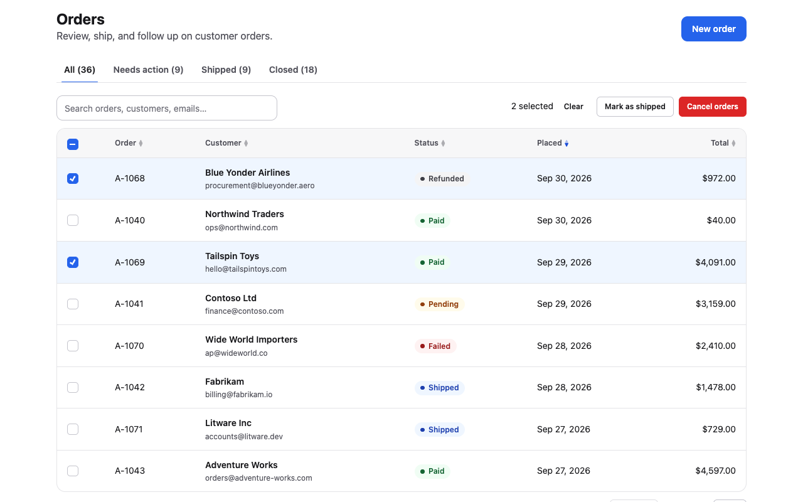
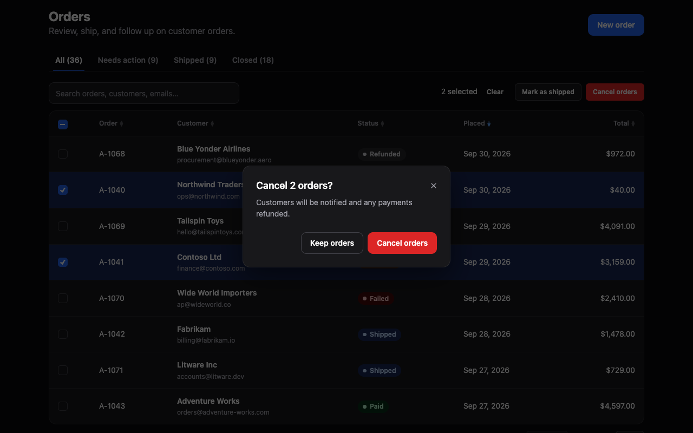
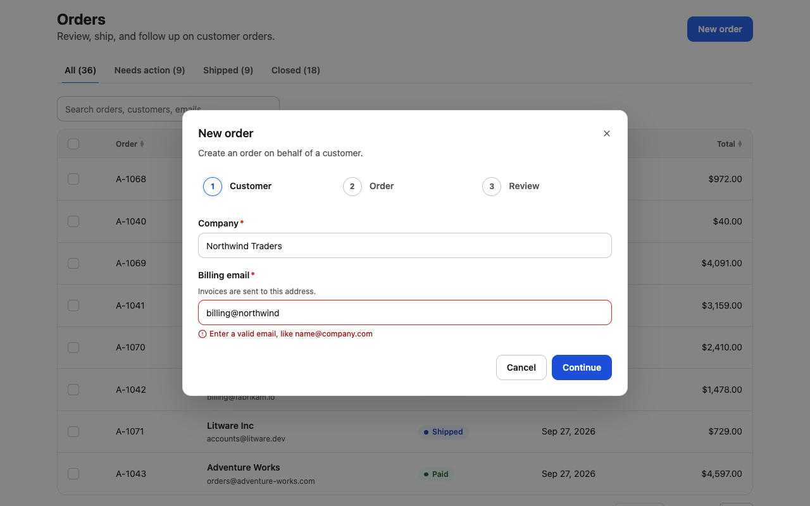
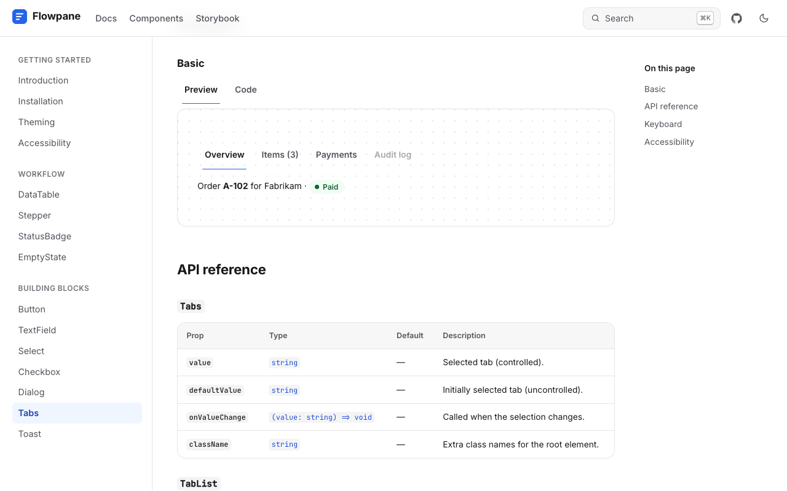
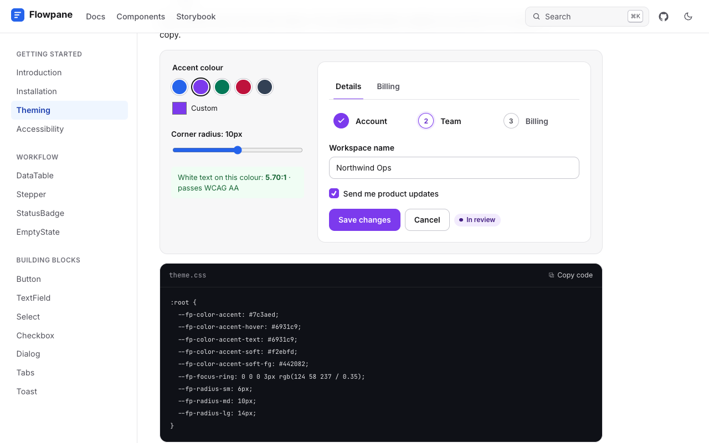

# Flowpane

Accessible React + TypeScript components for **admin panels, internal tools, and operational dashboards**.

Flowpane pairs the everyday building blocks (buttons, fields, dialogs, tabs, toasts) with the workflow pieces back-office screens keep needing: a sortable, searchable, selectable **DataTable** with bulk actions, a **Stepper** for multi-step flows, and consistent status and empty states. It is small, has no runtime dependencies besides React, and is themed with plain CSS variables.

**[Documentation & live examples](https://sudharshanpanidev.github.io/flowpane/)** · **[Storybook](https://sudharshanpanidev.github.io/flowpane/storybook/)**

> **Status:** v0.1.0. The API may change before 1.0. The package is built and validated but **not yet published to npm**.



## Highlights

- **Accessible by default.** WAI-ARIA patterns for dialogs, tabs, and tables; full keyboard support; focus management; live-region announcements for sorting, search results, and toasts.
- **Built for operational UIs.** A typed `DataTable<T>` with sorting, search, row selection, pagination, and a toolbar that receives the selection for bulk actions.
- **Themeable without a framework.** Plain CSS with `--fp-*` custom properties. Light and dark themes included; dark mode follows the OS or can be set explicitly. Default colour pairs meet WCAG AA contrast.
- **TypeScript first.** Strict types, generics where they help, and native HTML props on every primitive.
- **Small and dependency-free.** React is the only peer dependency. ESM and CommonJS builds with tree-shaking: an app that only uses `Button` doesn't ship the DataTable code.

## Components

| Workflow | |
| --- | --- |
| `DataTable` | Typed columns, natural sorting with `aria-sort`, search, row and page selection with an indeterminate "select all", pagination, bulk-action toolbar, empty and no-results states |
| `Stepper` | Progress through multi-step flows; announces "step 2 of 4, Current step"; completed steps can be revisited; horizontal or vertical |
| `StatusBadge` | Consistent status labels in five tones; colour is never the only signal |
| `EmptyState` | Empty and no-results views with a clear next step |

| Building blocks | |
| --- | --- |
| `Button` | Four variants, three sizes, icons, and a `loading` state that stays focusable |
| `TextField`, `Select` | Visible labels; descriptions and errors linked to the field; native `<select>` for robust keyboard and mobile behaviour |
| `Checkbox` | Native input with an indeterminate state |
| `Dialog` | Portal, focus trap, Escape to close, focus returned to the trigger, scroll lock, `alertdialog` for destructive confirmations |
| `Tabs` | Roving tabindex, arrow keys and Home/End, disabled tabs skipped, controlled or uncontrolled |
| `Toast` | Notifications region with `status`/`alert` roles, auto-dismiss that pauses on hover and focus, actions such as Undo |

## Installation

Requires React 18.2+ or 19.

```bash
npm install flowpane   # once published; see Status above
```

Import the stylesheet once at your app's entry point:

```tsx
import "flowpane/styles.css";
```

## Usage

```tsx
import { Button, DataTable, StatusBadge, type DataTableColumn } from "flowpane";

type Order = { id: string; customer: string; status: "Paid" | "Pending"; total: number };

const columns: DataTableColumn<Order>[] = [
  { id: "id", header: "Order", accessor: (o) => o.id, sortable: true },
  { id: "customer", header: "Customer", accessor: (o) => o.customer, sortable: true },
  {
    id: "status",
    header: "Status",
    accessor: (o) => o.status,
    cell: (o) => <StatusBadge tone={o.status === "Paid" ? "success" : "warning"}>{o.status}</StatusBadge>
  },
  { id: "total", header: "Total", accessor: (o) => o.total, sortable: true, align: "right" }
];

export function Orders({ orders }: { orders: Order[] }) {
  return (
    <DataTable
      data={orders}
      columns={columns}
      getRowId={(o) => o.id}
      caption="Recent orders"
      searchable
      selectable
      toolbar={({ selectedIds }) => selectedIds.length > 0 && <Button size="sm">Export {selectedIds.length}</Button>}
    />
  );
}
```

For toasts, wrap your app in `<ToastProvider>` once and call `toast()` from `useToast()`. Every component ships with a `"use client"` directive, so it works in the Next.js App Router.

## Theming

Override any `--fp-*` variable after importing the stylesheet, globally or on a wrapper element:

```css
:root {
  --fp-color-accent: #7c3aed;
  --fp-color-accent-hover: #6d28d9;
  --fp-radius-md: 6px;
}
```

Dark mode follows the operating system by default. Set `data-fp-theme="dark"` or `data-fp-theme="light"` on `<html>` (or any wrapper) to control it. The [theming guide](https://sudharshanpanidev.github.io/flowpane/docs/theming) has a live playground that shows contrast as you pick colours.

<table>
  <tr>
    <td></td>
    <td></td>
  </tr>
  <tr>
    <td></td>
    <td></td>
  </tr>
</table>

## Exploring the components

- **[Docs site](https://sudharshanpanidev.github.io/flowpane/):** live examples with copyable code, props tables, keyboard and accessibility notes for every component, plus an interactive Orders admin demo.
- **[Storybook](https://sudharshanpanidev.github.io/flowpane/storybook/):** every component state, with a light/dark toolbar toggle.

## Accessibility and testing

- 53 component tests (Vitest, Testing Library, user-event) cover keyboard behaviour, focus management, ARIA state, and user-visible output. Every component's suite includes an [axe-core](https://github.com/dequelabs/axe-core) check.
- CI runs the type check, the tests on **React 19 and React 18**, the package build, and the docs build.
- Before release, every docs page and Storybook story was audited with axe in Chrome in both themes, including colour contrast. This browser audit is not yet automated in CI.

## Local development

```bash
npm install
npm run dev          # docs site at http://localhost:5180
npm run storybook    # Storybook at http://localhost:6006
npm test             # unit and accessibility tests
npm run typecheck
npm run build        # ESM + CJS + type declarations + styles.css into dist/
npm run build:docs   # docs site + Storybook into site-dist/
npm run check        # typecheck, tests, and package build (runs before publishing)
```

Project layout: library source in `src/` (one folder per component with its tests and stories), design tokens and styles in `src/styles/`, and the documentation site in `site/`.

## Contributing

Issues and pull requests are welcome. Please keep changes focused, add or update tests for behaviour changes, and run `npm run check` before opening a pull request. New components should follow the existing patterns: native elements first, a visible label or accessible name, keyboard support, and an axe check in the tests.

## Roadmap

Combobox, DatePicker, Popover/Menu, column filters and column visibility for DataTable, server-side DataTable mode, and visual regression tests.

## License

[MIT](LICENSE) © Sudharshan Pani
